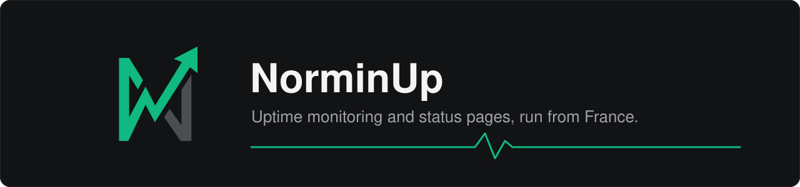

  

  
  
  
  

<a href="README.fr.md">Version française</a>

NorminUp checks your websites, APIs and services around the clock, alerts you the moment something breaks,
and gives your users a public status page so they know what is going on.

**[norminup.fr](https://norminup.fr)** · Free plan available.

---

### What it monitors

| | |
|---|---|
| **Web** | HTTP / HTTPS, keyword checks, redirects, SSL certificates and expiry |
| **Network** | TCP, UDP, ICMP (ping), DNS, domain expiry |
| **Real-time** | WebSocket, gRPC, heartbeats (cron jobs and scheduled tasks) |
| **Services** | SMTP, IMAP, MySQL / MariaDB, Redis, Docker containers, Discord bots |

### What you get

- **Alerts where you already are**: email, Discord, Slack, Telegram and webhooks.
- **Status pages**: public, with incidents and scheduled maintenance; on your own domain with a paid plan.
- **Badges and widgets**: show your live status on your own site or README.
- **Fewer false alarms**: a failure is retried before anyone gets paged.
- **Diagnostics**: when a check fails, NorminUp shows why (status code, certificate details, redirect chain,
  response time) rather than just "down".

### Why NorminUp

- **Checks run from France**, close to French and European users.
- **Built and run by one developer**, which means you talk to the person who wrote the code.

---

The code is not open source; this organization hosts the project's private repositories.
Questions or feedback: [norminup.fr](https://norminup.fr).
